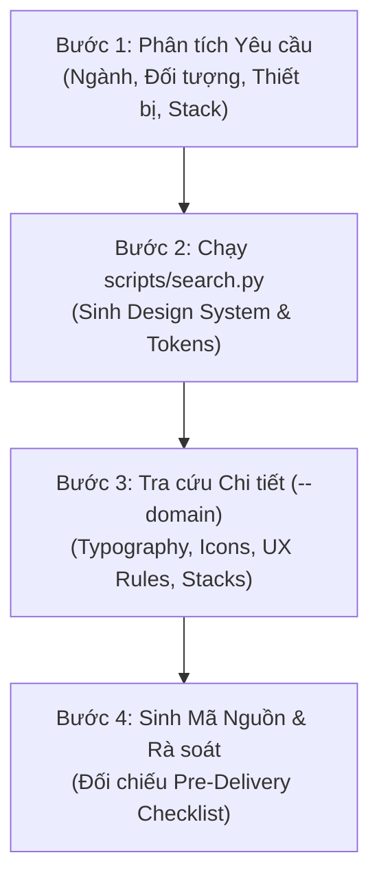

# 🎨 UI/UX Pro Max - Frontend Engineering & Design Intelligence

Kỹ năng thiết kế giao diện và phát triển Frontend toàn diện, chuẩn hóa dành cho AI Coding Assistant và lập trình viên. Cung cấp bộ tri thức thiết kế chuyên sâu có thể tra cứu ngoại tuyến (offline 100%), bao gồm:
- **80 Phong cách UI** (Glassmorphism, Bento Grid, Claymorphism, Swiss Minimalist, Neumorphism, Dark Mode, Brutalism...)
- **192 Bảng màu sản phẩm theo ngành** kèm mã Hex, semantic tokens và hồ sơ lý luận (Reasoning Profiles).
- **74 Cặp phông chữ chuyên nghiệp** tuyển chọn kèm link Google Fonts và định hướng cảm xúc (Mood/Brand fit).
- **120 Hướng dẫn trải nghiệm người dùng (UX Guidelines)** và tiêu chuẩn tiếp cận WCAG 2.2 AA.
- **25 Loại biểu đồ trực quan hóa dữ liệu (BI / Analytics Charts)**.
- **22 Tech Stacks**: React, Next.js, Vue, Nuxt, Svelte, Astro, HTML+Tailwind, shadcn/ui, Angular, Laravel, Flutter, SwiftUI, Jetpack Compose...
- **17 Preset hoạt ảnh GSAP / CSS Transitions**.

---

## 1. Khi nào Kích hoạt Kỹ năng này?

### ✅ Luôn sử dụng khi:
1. **Khởi tạo dự án hoặc trang mới:** Cần đề xuất hoặc thiết lập Design System, cấu trúc bố cục, chọn bảng màu, phông chữ và phong cách UI đồng nhất.
2. **Xây dựng hoặc Refactor UI Components:** Tạo các thành phần (Buttons, Modals, Forms, Tables, Cards, Navigation, Drawers, Tabs, Dropdowns...).
3. **Phát triển giao diện Dashboard / Analytics:** Thiết kế lưới Bento Grid, thẻ chỉ số KPI, biểu đồ trực quan và bộ lọc dữ liệu.
4. **Tối ưu trải nghiệm (UX Polish) & Tiếp cận (Accessibility):** Kiểm tra độ tương phản 4.5:1, điều hướng bàn phím (Keyboard navigation), trạng thái focus, hỗ trợ màn hình cảm ứng (Touch targets $\ge 44\times 44\text{px}$).
5. **Thiết kế Responsive & Vi tương tác (Micro-interactions):** Đảm bảo hiển thị hoàn hảo trên Mobile (375px), Tablet (768px), Laptop (1024px) và Desktop (1440px), hiệu ứng hover mượt mà 150-300ms.

### ❌ Bỏ qua khi:
- Các tác vụ thuần backend, database schema, migration script, logic server-side, DevOps/CI-CD không ảnh hưởng trực tiếp đến những gì người dùng **nhìn thấy, tương tác, hoặc cảm nhận trên màn hình**.

---

## 2. Ma trận Quy tắc Ưu tiên (Priority Matrix 1 → 10)

Tuân thủ nghiêm ngặt thứ tự ưu tiên từ **1 đến 10** khi đưa ra quyết định thiết kế:

| Ưu tiên | Hạng mục | Mức độ Ảnh hưởng | Lĩnh vực (`--domain`) | Tiêu chuẩn Bắt buộc (Must Have) | Anti-Patterns Cần Tránh (Avoid) |
|:---:|---|:---:|:---:|---|---|
| **1** | **Khả năng tiếp cận (Accessibility)** | **CRITICAL** | `ux` | Độ tương phản tối thiểu 4.5:1, Alt text cho ảnh, điều hướng bàn phím đầy đủ, Aria-labels cho nút icon | Xóa outline/focus ring, nút chỉ có icon không có label tiếp cận |
| **2** | **Cảm ứng & Tương tác (Touch & Interaction)** | **CRITICAL** | `ux` | Kích thước chạm tối thiểu $44\times 44\text{px}$, khoảng cách $\ge 8\text{px}$, phản hồi loading rõ ràng, `cursor: pointer` | Chỉ dựa vào hover (không dùng được trên mobile), chuyển trạng thái tức thì (0ms) |
| **3** | **Hiệu năng Giao diện (Performance)** | **HIGH** | `ux`, `react` | Định dạng ảnh hiện đại WebP/AVIF, Lazy loading, dự trữ sẵn khung ảnh (CLS $< 0.1$), ảo hóa danh sách dài | Layout thrashing, giật khung hình khi cuộn, tải ảnh gốc chưa nén |
| **4** | **Lựa chọn Phong cách (Style Selection)** | **HIGH** | `style`, `product` | Phù hợp loại sản phẩm và ngành nghề, tính nhất quán toàn diện, dùng biểu tượng vector SVG (Heroicons/Lucide) | Dùng Emoji làm icon hệ thống, pha trộn lộn xộn giữa Flat và Skeuomorphism |
| **5** | **Bố cục & Đáp ứng (Layout & Responsive)** | **HIGH** | `ux` | Thiết kế Mobile-first, thẻ `<meta name="viewport">`, không bao giờ để phát sinh thanh cuộn ngang ngoài ý muốn | Cố định chiều rộng dạng `px`, vô hiệu hóa tính năng zoom của người dùng |
| **6** | **Kiểu chữ & Màu sắc (Typography & Color)** | **MEDIUM** | `typography`, `color` | Cỡ chữ văn bản cơ bản $\ge 16\text{px}$, line-height 1.5, sử dụng CSS Semantic Tokens (`--color-primary`, `--color-surface`...) | Chữ thân bài $< 12\text{px}$, chữ xám trên nền xám, hardcode mã hex `#fff` rải rác |
| **7** | **Chuyển động & Hoạt ảnh (Motion)** | **MEDIUM** | `ux`, `gsap` | Thời lượng chuyển động phù hợp ngữ cảnh (150-300ms), truyền tải ý nghĩa không gian, tuân thủ `prefers-reduced-motion` | Dùng chung một thời lượng cho mọi hiệu ứng, animate thuộc tính `width`/`height` gây reflow |
| **8** | **Biểu mẫu & Phản hồi (Forms & Feedback)** | **MEDIUM** | `ux` | Nhãn form luôn hiển thị rõ ràng, thông báo lỗi đặt ngay cạnh ô nhập liệu, hướng dẫn chi tiết, xác thực từng bước | Chỉ dùng placeholder thay cho label, gom hết lỗi lên đỉnh trang, hiển thị quá tải |
| **9** | **Mô hình Điều hướng (Navigation)** | **HIGH** | `ux` | Nút Back hoạt động dự đoán được, thanh điều hướng dưới đáy (Bottom nav) $\le 5$ mục, hỗ trợ Deep Linking | Nhồi nhét quá nhiều menu cấp con, làm hỏng hành vi nút Back của trình duyệt |
| **10** | **Biểu đồ & Dữ liệu (Charts & Data)** | **LOW** | `chart` | Luôn có Chú giải (Legend), Tooltips chi tiết, bảng màu tương phản thân thiện với người mù màu | Dùng màu sắc đơn thuần để biểu đạt ý nghĩa mà không có nhãn hoặc ký hiệu đi kèm |

---

## 3. Hướng dẫn Sử dụng Công cụ Tìm kiếm Cục bộ (Offline Search Engine)

Công cụ tìm kiếm BM25 tích hợp sẵn chạy **100% offline bằng Python Standard Library** (không cần cài thêm thư viện ngoài).

### 3.1. Cú pháp Cơ bản

Đường dẫn tệp tìm kiếm:
```bash
python "<path-to-skill>/scripts/search.py" "<câu truy vấn>" [các tham số]
```
*(Trong workspace: `python .agents/skills/02-frontend-ui-ux-pro-max/scripts/search.py`)*

### 3.2. Sinh Toàn bộ Hệ thống Thiết kế (Design System Generator)
Dành cho dự án mới, trang mới hoặc chuẩn hóa nhận diện giao diện:

```bash
python scripts/search.py "enterprise bpm workflow dashboard" --design-system -p "BpmPortal"
```

**Đầu ra tự động bao gồm:**
- **Mẫu bố cục (Layout Pattern):** Phân chia các phần (Hero, KPI Grid, Data Table, Activity Stream).
- **Phong cách UI (Recommended Style):** Đề xuất phong cách tối ưu theo ngành (vd: Swiss Minimalist hoặc Bento Grid).
- **Hệ màu sắc (Color Tokens):** Đầy đủ Primary, Secondary, Accent/CTA, Background, Card, Border, Destructive...
- **Cặp phông chữ (Typography Pairings):** Cặp font tiêu đề và font nội dung kèm mã `@import Google Fonts`.
- **Hiệu ứng chính & Anti-patterns:** Danh sách những hiệu ứng nên làm và **những điều cấm kỵ theo ngành**.
- **Danh sách kiểm tra (Pre-delivery Checklist).**

### 3.3. Tự động Lưu trữ Thiết kế (Master + Overrides Pattern)
Sử dụng tham số `--persist` và `--output-dir` để lưu lại quyết định thiết kế vào dự án:

```bash
python scripts/search.py "medical clinic patient portal" --design-system --persist -p "MedPortal" --output-dir "."
```
Hệ thống sẽ tự động tạo cấu trúc:
- `design-system/medportal/MASTER.md`: Quy chuẩn thiết kế chung cho toàn bộ dự án.
- `design-system/medportal/pages/`: Thư mục chứa các tinh chỉnh riêng cho từng trang (khi dùng `--page <page-name>`).

### 3.4. Tinh chỉnh Bộ thanh trượt Thiết kế (Design Dials 1 - 10)
Tùy biến cảm xúc thiết kế mà không cần đổi từ khóa:
- `--variance <1-10>`: Mức độ phá cách (1 = Tối giản/Cân đối, 10 = Bất đối xứng/Đột phá).
- `--motion <1-10>`: Cường độ hoạt ảnh (1 = Vi tương tác tinh tế, 10 = Chuyển động phức tạp/GSAP).
- `--density <1-10>`: Mật độ hiển thị (1 = Rộng rãi/Marketing, 10 = Cô đọng/Dashboard giám sát tải cao).

*Ví dụ cho Dashboard Doanh nghiệp mật độ cao:*
```bash
python scripts/search.py "b2b saas analytics console" --design-system --variance 4 --motion 3 --density 9 -p "Analytics"
```

### 3.5. Tra cứu Chuyên sâu theo Từng Domain
Khi cần giải quyết một vấn đề cụ thể của giao diện:

| Nhu cầu Thiết kế | Lệnh Tra cứu | Ví dụ Thực tế |
|---|---|---|
| **Chọn Phong cách UI** | `--domain style` | `python scripts/search.py "glassmorphism modern dark" --domain style` |
| **Bảng màu theo ngành** | `--domain color` | `python scripts/search.py "fintech banking trustworthy" --domain color` |
| **Cặp Font chữ** | `--domain typography` | `python scripts/search.py "editorial elegant modern" --domain typography` |
| **Tra cứu Google Fonts** | `--domain google-fonts` | `python scripts/search.py "sans-serif high readability" --domain google-fonts` |
| **Lựa chọn Biểu đồ** | `--domain chart` | `python scripts/search.py "time-series bottleneck latency" --domain chart` |
| **Quy tắc Trải nghiệm UX** | `--domain ux` | `python scripts/search.py "table pagination bulk selection" --domain ux` |
| **Khả năng tiếp cận WCAG**| `--domain ux` | `python scripts/search.py "keyboard focus visible ring modal" --domain ux` |
| **Cấu trúc Landing Page** | `--domain landing` | `python scripts/search.py "saas pricing comparison" --domain landing` |
| **Biểu tượng SVG Chuẩn** | `--domain icons` | `python scripts/search.py "navigation chevron filter status" --domain icons` |
| **Hoạt ảnh GSAP / Motion** | `--domain gsap` | `python scripts/search.py "stagger fade-up list item" --domain gsap` |
| **Tối ưu React / Next.js** | `--domain react` | `python scripts/search.py "virtualized list heavy render memo" --domain react` |

### 3.6. Tra cứu Hướng dẫn cho Từng Công nghệ (Tech Stack)
```bash
python scripts/search.py "table responsive sorting" --stack html-tailwind
python scripts/search.py "state management form validation" --stack react
python scripts/search.py "responsive layout drawer" --stack flutter
```
*Các Stack hỗ trợ:* `html-tailwind`, `shadcn`, `react`, `nextjs`, `vue`, `nuxtjs`, `nuxt-ui`, `svelte`, `astro`, `angular`, `laravel`, `flutter`, `swiftui`, `jetpack-compose`, `threejs`.

---

## 4. Phân tích Mẫu Tham chiếu Thực tế (Showcase Previews)

Kỹ năng đi kèm các mẫu giao diện hoàn chỉnh tại thư mục [`preview/`](file:///d:/My%20Project/TK.BPMN/.agents/skills/02-frontend-ui-ux-pro-max/preview/):

### 4.1. Mẫu Ứng dụng Di động Pet Tech: [`xiaomaomi-app.html`](file:///d:/My%20Project/TK.BPMN/.agents/skills/02-frontend-ui-ux-pro-max/preview/xiaomaomi-app.html)
Được xây dựng từ hệ thống thiết kế tự động của UI/UX Pro Max:
- **Hệ màu sắc:** Nhận diện thương hiệu ấm áp (`--primary: #F97316`, `--background: #FFF7ED`, `--foreground: #9A3412`).
- **Phong cách Claymorphism:** Đổ bóng hai lớp mềm mại (`--shadow-clay`, `--shadow-card`), bo tròn thẻ thân thiện (`--radius-card: 20px`).
- **Typography:** Font tiêu đề sinh động (Fredoka) kết hợp font thân bài dễ đọc (Nunito).
- **Tương tác di động:** Thanh điều hướng dưới đáy (Bottom Navigation) với hiệu ứng active indicator nổi bật, thẻ trạng thái tương tác và danh sách có thể cuộn mượt mà.

### 4.2. Mẫu Dashboard Doanh nghiệp Quản trị Quy trình (Enterprise BPM / BI)
Đối với ứng dụng quản trị doanh nghiệp, kỹ năng áp dụng phong cách **Swiss Minimalist & Bento Grid**:
- **Bảng màu:** Xanh tin cậy Navy (`#1E3A5F`), Xanh điểm nhấn (`#2563EB`), Xanh thành công (`#16A34A`), Nền trung tính (`#F8FAFC`).
- **Kiểu chữ:** Lexend hoặc Inter kết hợp Fira Code cho dữ liệu mã số / số tiền.
- **Bố cục:** Lưới Bento phân cấp rõ ràng giữa Thẻ KPI tổng quan, Bộ lọc nhanh, Bảng công việc cần duyệt và Biểu đồ Heatmap thắt nút cổ chai.

### 4.3. Mẫu Biểu mẫu Động Doanh nghiệp (Form.io Cascading) & Nhúng Workflow Designer (Elsa Studio / BPMN) — Kế thừa Toàn diện Skill 02
Kỹ năng bao gồm toàn bộ năng lực chuyên sâu của Skill 02 cũ (Form.io, AdminLTE 3, Elsa Studio) tại thư mục [`examples/enterprise-bpm/`](file:///d:/My%20Project/TK.BPMN/.agents/skills/02-frontend-ui-ux-pro-max/examples/enterprise-bpm/) và tài liệu đặc tả [`references/enterprise-forms-and-workflow-studio.md`](file:///d:/My%20Project/TK.BPMN/.agents/skills/02-frontend-ui-ux-pro-max/references/enterprise-forms-and-workflow-studio.md):
- **Form.io Cascading Loading:** Cấu hình `dataSrc: 'url'`, URL động `{{ data.parentId }}`, bắt buộc thiết lập `clearOnRefresh: true` và `customConditional: "show = !!data.parentId;"` (Tham chiếu mã mẫu: [`formio-cascading-schema.json`](file:///d:/My%20Project/TK.BPMN/.agents/skills/02-frontend-ui-ux-pro-max/examples/enterprise-bpm/formio-cascading-schema.json)).
- **Nhúng Visual Workflow Designer:** Hỗ trợ Web Components `<elsa-workflow-definition-editor>` hoặc IFrame Sandbox cách ly với bảo mật JWT Bearer Header (Tham chiếu mã mẫu: [`elsa-studio-view.cshtml`](file:///d:/My%20Project/TK.BPMN/.agents/skills/02-frontend-ui-ux-pro-max/examples/enterprise-bpm/elsa-studio-view.cshtml)).
- **Dashboard Doanh nghiệp Real-time:** Tích hợp SignalR / WebSockets cập nhật tức thời số lượng công việc đến hạn (Pending Badges) và cảnh báo vi phạm SLA.

---

## 5. Quy trình 4 Bước Phát triển Giao diện của Agent

Khi người dùng yêu cầu tạo trang hoặc thành phần mới:



1. **Bước 1 — Phân tích yêu cầu:** Xác định rõ ngành hàng (Tài chính, Y tế, BPM Doanh nghiệp, Thương mại điện tử...), đối tượng người dùng, thiết bị mục tiêu và tech stack của dự án.
2. **Bước 2 — Sinh Design System:** Chạy `python scripts/search.py "<loại sản phẩm>" --design-system` để xác lập bảng màu, phông chữ, mẫu bố cục và anti-pattern cần tránh.
3. **Bước 3 — Bổ sung tri thức chuyên biệt:** Tra cứu thêm quy tắc UX cho bảng dữ liệu, modal hoặc form nếu cần (`--domain ux`, `--domain chart`).
4. **Bước 4 — Viết mã & Đối chiếu checklist:** Viết code hoàn chỉnh, sạch đẹp, đúng chuẩn semantic HTML/CSS, và kiểm tra lại toàn bộ danh mục nghiệm thu trước khi bàn giao.

---

## 6. Danh mục Kiểm tra Nghiệm thu Trước khi Bàn giao (Pre-Delivery Checklist)

Trước khi gửi mã nguồn giao diện cho người dùng, Agent **PHẢI** tự kiểm tra các tiêu chí sau:

- [ ] **Icon System:** Tuyệt đối không dùng Emoji làm biểu tượng hệ thống. Luôn dùng biểu tượng vector SVG (Lucide, Heroicons, FontAwesome hoặc Phosphor).
- [ ] **Con trỏ Tương tác:** Luôn có `cursor: pointer` trên mọi phần tử có thể nhấp (Buttons, Links, Checkboxes, Selectable Cards, Badges có action).
- [ ] **Hiệu ứng Chuyển tiếp:** Toàn bộ trạng thái hover, focus, active có transition mượt mà trong khoảng **150ms – 300ms** (không chuyển trạng thái giật cục 0ms).
- [ ] **Độ tương phản Văn bản:** Đạt tối thiểu **4.5:1** cho văn bản thường và **3:1** cho tiêu đề lớn theo chuẩn WCAG AA. Tuyệt đối không để chữ xám mờ trên nền xám.
- [ ] **Điều hướng Bàn phím:** Có hiển thị viền focus rõ ràng (`outline` hoặc `ring`) khi người dùng duyệt bằng phím `Tab`, không bị ẩn mất.
- [ ] **Hỗ trợ Chuyển động An toàn:** Bổ sung media query `@media (prefers-reduced-motion: reduce)` để tắt hoặc giảm thiểu hiệu ứng cho người dùng nhạy cảm thị giác.
- [ ] **Ngắt dòng & Tràn văn bản:** Nhãn nút, badge, chip và tiêu đề phải tự co giãn hoặc xuống dòng an toàn, không bị tràn (overflow) cắt cụt mất chữ trên màn hình hẹp.
- [ ] **Độ rộng Responsive:** Kiểm tra hiển thị chuẩn xác trên 4 mốc màn hình chuẩn: **375px** (Mobile), **768px** (Tablet), **1024px** (Laptop nhỏ), **1440px** (Desktop lớn). Không phát sinh thanh cuộn ngang toàn trang.

