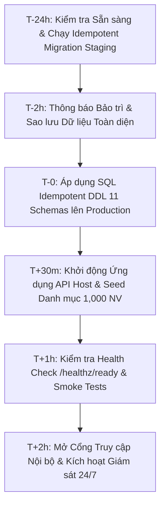

# 🚀 Enterprise BPM Platform - Production Go-Live & Cutover Runbook

**Tài liệu:** Sổ tay Hướng dẫn Triển khai Cắt chuyển Vận hành Sản xuất (Go-Live Runbook)  
**Hệ thống:** Nền tảng Quản trị Quy trình Doanh nghiệp Toàn diện (Modular Monolith)  
**Phiên bản:** Production 1.0.0 (Hoàn tất Sprint 08)  
**Ngày phát hành:** 09/11/2026  

---

## 1. Yêu cầu Hạ tầng & Môi trường Sản xuất (Prerequisites)

| Thành phần | Tiêu chuẩn Khuyến nghị | Ghi chú & Cấu hình |
|---|---|---|
| **Máy chủ Ứng dụng** | 4 Cores, 16 GB RAM (Cluster 2 Nodes) | Windows Server 2022 / Ubuntu 24.04 LTS (Docker / K8s) |
| **Cơ sở Dữ liệu SQL** | Microsoft SQL Server 2019/2022 Enterprise | Cấu hình Max Degree of Parallelism (MAXDOP) = 4, Read Committed Snapshot Isolation (RCSI) = ON |
| **Redis Cache Cluster** | Redis v7.2+ (Memory 4 GB, High Availability) | Cấu hình Memory Eviction `allkeys-lru`, kết nối qua SSL |
| **Vector Database** | Qdrant v1.8+ (Memory 8 GB, Storage SSD) | Phục vụ RAG Tra cứu Quy chế Doanh nghiệp |
| **File Storage** | Microsoft 365 OneDrive for Business / Azure Blob | Lưu trữ tệp đính kèm và biểu mẫu Word/PDF |

---

## 2. Kế hoạch Thời gian Cắt chuyển (Go-Live Timeline)



---

## 3. Quy trình Triển khai Chi tiết Từng Bước (Step-by-step Execution)

### Bước 1: Sao lưu Cơ sở Dữ liệu (Full Database Backup)
```sql
BACKUP DATABASE [EnterpriseBpmDb]
TO DISK = N'D:\Backups\EnterpriseBpmDb_PreGoLive_20261109.bak'
WITH FORMAT, INIT, COMPRESSION, CHECKSUM, STATS = 10;
```

### Bước 2: Thực thi Cập nhật CSDL Idempotent (11 Schemas)
Thực thi script: `scripts/database/idempotent-production-migration.sql`
```powershell
sqlcmd -S prod-sql-server -d EnterpriseBpmDb -i scripts/database/idempotent-production-migration.sql
```
*Xác nhận: Toàn bộ 11 schemas (`auth`, `audit`, `org`, `form`, `workflow`, `document`, `notification`, `news`, `settings`, `ai`, `analytics`) và các Filtered Indexes được tạo thành công.*

### Bước 3: Triển khai Ứng dụng API Host (Container Deployment)
```bash
docker pull ghcr.io/enterprise-bpm/platform-apihost:latest
docker run -d \
  --name enterprise-bpm-api \
  --restart always \
  -p 5000:8080 \
  -e ASPNETCORE_ENVIRONMENT=Production \
  -e ConnectionStrings__DefaultConnection="Server=prod-sql-server;Database=EnterpriseBpmDb;User Id=sa;Password=***;TrustServerCertificate=True;MultipleActiveResultSets=true;Max Pool Size=256;" \
  -e ConnectionStrings__Redis="prod-redis-cluster:6379,password=***,abortConnect=false" \
  -e Qdrant__Endpoint="http://prod-qdrant:6333" \
  ghcr.io/enterprise-bpm/platform-apihost:latest
```

### Bước 4: Kiểm tra Sức khỏe Hệ thống (Readiness Health Check)
```bash
curl -i http://localhost:5000/healthz/ready
```
**Kết quả mong đợi:** Mã HTTP `200 OK` với thân JSON:
```json
{
  "status": "Healthy",
  "totalDurationMs": 18.45,
  "entries": [
    { "key": "sql_server", "status": "Healthy", "description": "Kết nối Microsoft SQL Server hoạt động bình thường (SELECT 1 thành công)." },
    { "key": "redis_cluster", "status": "Healthy", "description": "Redis Distributed Cache phản hồi tốt (Set/Get ping thành công)." },
    { "key": "onedrive_storage", "status": "Healthy", "description": "Hệ thống lưu trữ tệp đính kèm và tài liệu OneDrive sẵn sàng." },
    { "key": "qdrant_vector_db", "status": "Healthy", "description": "Qdrant Vector DB Endpoint & Resilient In-Memory Fallback sẵn sàng hoạt động." }
  ]
}
```

---

## 4. Kế hoạch Dự phòng & Khôi phục Sự cố (Rollback Strategy)

Nếu phát hiện sự cố nghiêm trọng (Critical Bug, Block toàn bộ giao dịch, DB Data Corruption):
1. **Thông báo khẩn cấp:** Đội trưởng Go-Live kích hoạt quy trình Rollback trong vòng 15 phút.
2. **Dừng Traffic:** Chuyển hướng người dùng sang trang thông báo bảo trì tạm thời.
3. **Phục hồi Cơ sở Dữ liệu:**
   ```sql
   ALTER DATABASE [EnterpriseBpmDb] SET SINGLE_USER WITH ROLLBACK IMMEDIATE;
   RESTORE DATABASE [EnterpriseBpmDb]
   FROM DISK = N'D:\Backups\EnterpriseBpmDb_PreGoLive_20261109.bak'
   WITH REPLACE;
   ALTER DATABASE [EnterpriseBpmDb] SET MULTI_USER;
   ```
4. **Khôi phục Image trước đó:** Rollback container về phiên bản `v0.9.8-stable`.
5. **Họp Post-Mortem:** Xác định nguyên nhân gốc rễ và lên kế hoạch xử lý.

---

## 5. Giám sát Sau Go-Live (Post Go-Live Monitoring & Alerting)

- **Giám sát APM (Prometheus / Grafana / Serilog):**
  - Tỷ lệ lỗi HTTP 5xx: `< 0.05%`.
  - Thời gian phản hồi P99: `< 30ms` cho truy vấn đọc và `< 100ms` cho giao dịch ghi.
  - Tần suất ngắt mạch (Circuit Breaker Trips): `= 0` đối với các dịch vụ ngoài.
  - Độ trễ xử lý Outbox Message: `< 5s`.
- **Đường dây nóng hỗ trợ người dùng (Hotline 24/7):**
  - Kênh Slack/Teams: `#bpm-prod-support`.
  - Trực chiến cấp 1 (Helpdesk) & Cấp 2 (Core Dev Team).

