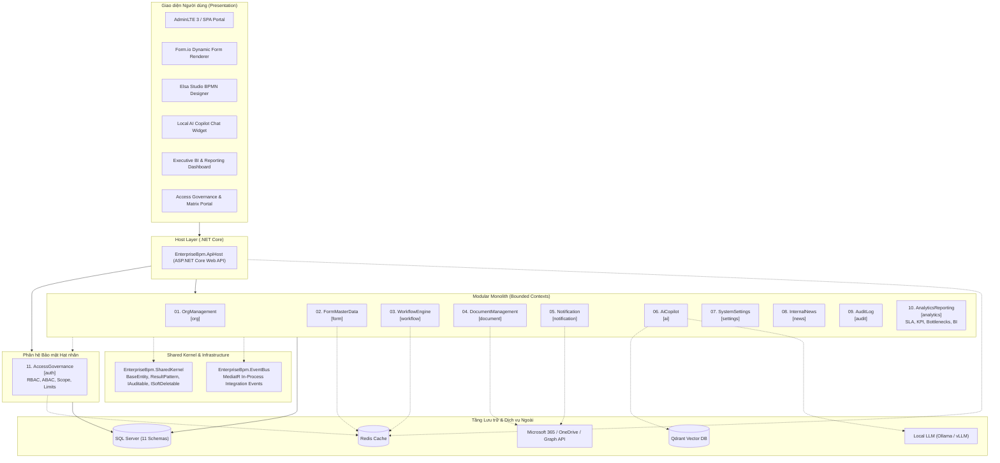

# 📚 Enterprise BPMN Platform — Architecture & Modules Documentation

Chào mừng đến với bộ tài liệu đặc tả kiến trúc kỹ thuật và nghiệp vụ của nền tảng **Enterprise BPMN Platform** (Virtual Office). Hệ thống được thiết kế theo mô hình **Modular Monolith** hiện đại trên nền tảng **.NET Core (.NET 8/9)**, sử dụng **SQL Server Multi-Schema**, **Elsa Workflows v3**, **Form.io**, **Microsoft 365 / Graph API**, **Local AI Copilot (Model Context Protocol - MCP)**, và **Hệ thống Quản trị Phân quyền & Báo cáo Toàn diện cấp Doanh nghiệp**.

---

## 🗂️ Danh mục Tài liệu Đặc tả (11 Modules + 1 Shared Kernel)

| Thứ tự | Mã Module | Tên Tài liệu | Database Schema | Phạm vi Trách nhiệm Chính |
|:---:|---|---|:---:|---|
| **00** | **SharedKernel** | [00-shared-kernel-architecture.md](00-shared-kernel-architecture.md) | — | Cấu trúc Solution, Base Entity, IAuditable, ISoftDeletable, Integration Events, NetArchTest boundary checks. |
| **01** | **OrgManagement** | [01-org-management.md](01-org-management.md) | `[org]` | Cây phân cấp tổ chức (Tập đoàn $\rightarrow$ Nhóm), Quản lý Nhân sự, Chức danh (`Positions`), Cơ chế Ủy quyền (Delegation), Danh bạ Nội bộ (`Directory API`). |
| **02** | **FormMasterData** | [02-form-master-data.md](02-form-master-data.md) | `[form]` | Quản lý JSON Schema Form.io, Form Versioning (`IsLatest`), Master Data tập trung hỗ trợ Cascading Loading & Redis Caching. |
| **03** | **WorkflowEngine** | [03-workflow-engine.md](03-workflow-engine.md) | `[workflow]` | Trái tim điều phối quy trình với Elsa Workflows v3, Custom Activity, Bookmark/Resume, Lịch sử duyệt bất biến (`ApprovalHistory`), Quản lý SLA & Escalation. |
| **04** | **DocumentManagement** | [04-document-management.md](04-document-management.md) | `[document]` | Quản lý file đính kèm với Microsoft Graph API / OneDrive for Business, Tự động sinh văn bản từ Template (Word/PDF). |
| **05** | **Notification** | [05-notification.md](05-notification.md) | `[notification]` | Cổng thông báo tập trung đa kênh (O365 Mail, Teams Webhook, Zalo ZNS, SMS Gateway) với cơ chế Event-Driven & Exponential Backoff. |
| **06** | **AiCopilot** | [06-ai-copilot.md](06-ai-copilot.md) | `[ai]` | Local MCP Server kết nối Local LLM (Ollama/vLLM), RAG tra cứu Quy chế & Chính sách nội bộ bằng Qdrant Vector DB. |
| **07** | **SystemSettings** | [07-system-settings.md](07-system-settings.md) | `[settings]` | Cấu hình tham số hệ thống, thương hiệu doanh nghiệp (White-labeling), mã hóa At-Rest và truy vết lịch sử thay đổi cấu hình. |
| **08** | **InternalNews** | [08-internal-news.md](08-internal-news.md) | `[news]` | Bản tin, truyền thông nội bộ, bài viết khẩn cấp, hẹn giờ xuất bản, xác nhận bắt buộc đọc tin (Read Receipts). |
| **09** | **AuditLog** | [09-audit-log.md](09-audit-log.md) | `[audit]` | Ghi nhận toàn bộ thao tác CUD, đăng nhập/bảo mật, Trigger bất biến (Append-Only Log) phục vụ thanh kiểm tra và kiểm toán. |
| **10** | **AnalyticsReporting** | [10-analytics-reporting.md](10-analytics-reporting.md) | `[analytics]` | **Phân hệ Báo cáo Toàn hệ thống**: Đo lường SLA theo Giờ làm việc thực tế (Business Hours), Phân tích Nút thắt cổ chai (Bottlenecks), Scorecard Năng suất nhân sự, Báo cáo Tài chính/Ngân sách, Dynamic Report Builder, Tự động phân phối báo cáo định kỳ. |
| **11** | **AccessGovernance** | [11-access-governance.md](11-access-governance.md) | `[auth]` | **Phân hệ Quản trị Phân quyền Toàn hệ thống**: Mô hình lai RBAC/ABAC, Quyền hạt nhân (`resource:action`), Nhóm bảo mật, Kiểm soát phạm vi dữ liệu (`DataScope`), Hạn mức phê duyệt tài chính, Ma trận phân quyền Form & Menu. |

---

## 🏛️ Sơ đồ Kiến trúc Tổng thể (High-Level Architecture)

---

## 🔒 Quy tắc Ranh giới Kiến trúc (Architectural Governance)

1. **Ranh giới Schema Database:** Mỗi module sở hữu schema riêng biệt trên SQL Server (`[org]`, `[form]`, `[workflow]`, `[document]`, `[notification]`, `[ai]`, `[settings]`, `[news]`, `[audit]`, `[analytics]`, `[auth]`). Tuyệt đối không cho phép truy vấn trực tiếp bảng của module khác thông qua EF Core DbContext.
2. **Giao tiếp qua Hợp đồng (Contract-Based Communication):** Mọi giao tiếp đồng bộ giữa các module bắt buộc phải thông qua Public Interfaces (ví dụ: `IPermissionEvaluator`, `IOrgHierarchyService`, `ISlaCalculationEngine`).
3. **Giao tiếp Bất đồng bộ (Event-Driven Integration):** Các luồng phản hồi nghiệp vụ (ví dụ: Phiếu duyệt $\rightarrow$ gửi thông báo, sinh tài liệu, cập nhật BI) bắt buộc sử dụng MediatR Integration Events kế thừa từ `BaseIntegrationEvent`.
4. **Kiểm tra Ranh giới Tự động:** Sử dụng `NetArchTest` trong project `EnterpriseBpm.ArchTests` để tự động chặn các commit vi phạm tham chiếu giữa các tầng hoặc các module.
