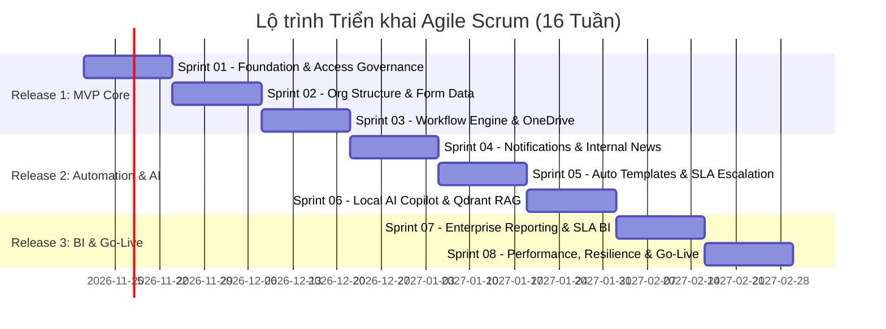

# 📋 Enterprise BPMN Platform — Agile Scrum Master Plan & Roadmap

Nền tảng **Enterprise BPMN Platform** được triển khai theo phương pháp luận **Agile Scrum Framework** kết hợp các tiêu chuẩn kỹ thuật **Modular Monolith**, bảo đảm chuyển giao giá trị nghiệp vụ liên tục, có thể kiểm thử và đo lường được sau mỗi chu kỳ Sprint.

---

## 1. Tổng quan Dự án & Khung Vận hành Scrum

### 1.1. Thông số Vận hành Scrum
- **Chu kỳ Sprint (Sprint Cadence):** $2\text{ tuần}$ ($10\text{ ngày làm việc}$).
- **Quy mô Nhóm phát triển (Scrum Team):** 6 - 8 thành viên:
  - 1 Product Owner (PO)
  - 1 Scrum Master / Tech Lead
  - 3 Backend Engineers (.NET Core, SQL Server, Elsa Workflows, Dapper)
  - 2 Frontend Engineers (AdminLTE, Form.io, JavaScript/TypeScript, ApexCharts)
  - 1 QA / Automation Test Engineer
- **Capacity chuẩn mỗi Sprint:** $\approx 60 - 70\text{ Story Points}$ ($\approx 320 - 360\text{ Giờ Kỹ thuật khả dụng}$).
- **Tổng số Sprints:** 8 Sprints ($16\text{ tuần} \approx 4\text{ tháng}$).

---

## 2. Lộ trình Phát hành (Release Roadmap)

Hệ thống được chia thành **3 giai đoạn Phát hành (Release Milestones)** để từng bước đưa vào thử nghiệm và vận hành thực tế:

### Chi tiết các Cột mốc Release:

| Cột mốc | Tên Gói Phát hành | Các Sprint bao gồm | Mục tiêu Nghiệp vụ Bàn giao |
|:---:|---|:---:|---|
| **Release 1** | **Core Foundation & Basic BPMN (MVP)** | **Sprint 01, 02, 03** | Khung giải pháp, SharedKernel, Phân quyền RBAC/ABAC toàn hệ thống, Cơ cấu tổ chức cây, Form.io cascading, Quy trình trình ký cốt lõi với Elsa v3, Bookmark/Resume, Ký duyệt đa cấp, Lưu trữ file OneDrive, Log kiểm toán. |
| **Release 2** | **Enterprise Automation & AI Copilot** | **Sprint 04, 05, 06** | Thông báo tự động đa kênh (O365 Mail, Teams, SMS/Zalo), Bản tin nội bộ hẹn giờ đăng, Sinh văn bản quyết định phê duyệt tự động từ Word/PDF, Quản lý trễ hạn SLA, Trợ lý AI Copilot tra cứu quy chế nội bộ qua Qdrant. |
| **Release 3** | **Advanced Reporting & Production Go-Live** | **Sprint 07, 08** | Báo cáo toàn hệ thống, Phân tích nút thắt cổ chai, Đo lường SLA theo giờ làm việc, Scorecard nhân viên, Dynamic Report Builder, Tối ưu hóa hiệu năng cao (Redis L1/L2, Dapper), Khả năng chịu lỗi Polly v8, Cắt chuyển Go-Live chính thức. |

---

## 3. Tiêu chí Sẵn sàng (DoR) & Tiêu chí Hoàn thành (DoD)

### 3.1. Definition of Ready (DoR) — Tiêu chuẩn để Đưa User Story vào Sprint
- [x] User Story được viết theo định dạng chuẩn: `Là [Vai trò], tôi muốn [Hành động] để [Lợi ích]`.
- [x] Có đầy đủ tiêu chí chấp thuận (Acceptance Criteria) viết theo cú pháp **Gherkin (Given - When - Then)**.
- [x] Đã được PO và Tech Lead làm rõ ranh giới Bounded Context và Schema DB tương ứng.
- [x] Đã ước lượng Story Points thông qua Planning Poker.
- [x] Không bị phụ thuộc (blocking dependencies) vào các Story chưa hoàn thành.

### 3.2. Definition of Done (DoD) — Tiêu chuẩn để Release User Story
- [x] **Code Complete:** Code tuân thủ Clean Architecture, không vi phạm các quy tắc kiến trúc trong `00-shared-kernel-architecture.md`.
- [x] **Architecture Tests:** Vượt qua $100\%$ các bài kiểm tra ranh giới phụ thuộc với `NetArchTest`.
- [x] **Unit & Integration Tests:** Đạt độ bao phủ Code Coverage tối thiểu **$80\%$** cho tầng Domain & Application Logic.
- [x] **Database & Migrations:** Migration SQL Server chạy thành công, có đầy đủ Index tối ưu và Soft Delete query filter.
- [x] **Auditing & Security:** Thao tác CUD được ghi nhận qua `AuditSaveChangesInterceptor`, quyền hạn được bảo vệ bằng `[RequirePermission]`.
- [x] **Code Review:** Được ít nhất 1 Senior Engineer / Tech Lead phê duyệt Pull Request.
- [x] **CI/CD Build:** Pipeline build tự động thành công, không có lỗi phân tích tĩnh (SonarQube / Roslyn Analyzers).
- [x] **PO Acceptance:** Product Owner xác nhận nghiệm thu tính năng trên môi trường Staging/UAT.

---

## 4. Mục lục Các Tệp Kế hoạch Chi tiết theo Sprint

| Tệp Kế hoạch Sprint | Tên Sprint | Module Trọng tâm | Trạng thái |
|---|---|:---:|:---:|
| [00-product-backlog.md](00-product-backlog.md) | **Master Product Backlog** | Tất cả 11 Modules | ✅ Đã lập |
| [sprint-01-foundation-access.md](sprint-01-foundation-access.md) | **Sprint 01: Architecture, Access Governance & Audit** | Kernel, Auth, Audit | ✅ Đã lập |
| [sprint-02-org-form-masterdata.md](sprint-02-org-form-masterdata.md) | **Sprint 02: Org Structure, Positions & Form Master Data** | Org, Form | ✅ Đã lập |
| [sprint-03-workflow-documents.md](sprint-03-workflow-documents.md) | **Sprint 03: Elsa BPMN Engine & OneDrive Storage** | Workflow, Document | ✅ Đã lập |
| [sprint-04-notification-news.md](sprint-04-notification-news.md) | **Sprint 04: Multichannel Notification & Internal News** | Notification, News, Settings | ✅ Đã lập |
| [sprint-05-templates-sla-escalation.md](sprint-05-templates-sla-escalation.md) | **Sprint 05: Document Templates & SLA Escalation** | Document, Workflow | ✅ Đã lập |
| [sprint-06-ai-copilot-rag.md](sprint-06-ai-copilot-rag.md) | **Sprint 06: Multi-Provider AI Assistant (Gemini, ChatGPT, Claude, Local MCP) & Qdrant RAG** | AiAssistant | ✅ Đã lập |
| [sprint-07-analytics-reporting.md](sprint-07-analytics-reporting.md) | **Sprint 07: Enterprise Reporting & SLA Business Hours** | AnalyticsReporting | ✅ Đã lập |
| [sprint-08-performance-hardening.md](sprint-08-performance-hardening.md) | **Sprint 08: High Performance, Resilience & Go-Live** | Tuning, Resilience, QA | ✅ Đã lập |
| [release-governance-report.md](release-governance-report.md) | **Báo cáo Đánh giá, Release Criteria & Quản trị Rủi ro** | Toàn hệ thống | ✅ Đã lập |

