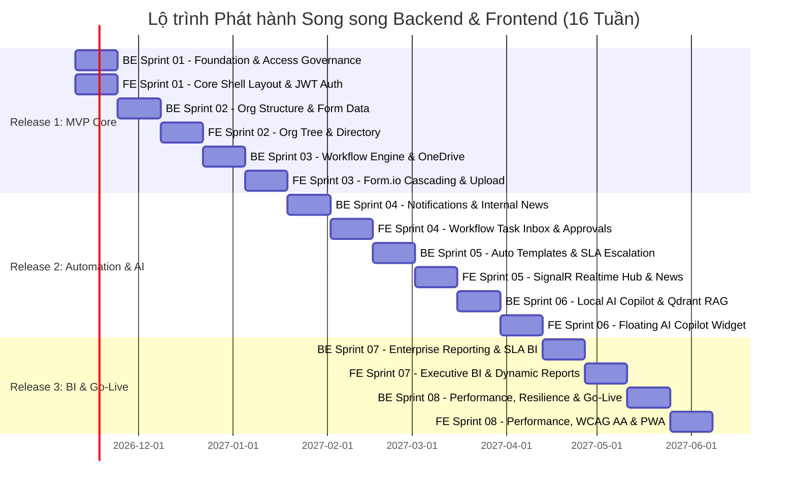

# 📋 Enterprise BPMN Platform — Agile Scrum Master Plan & Roadmap

Nền tảng **Enterprise BPMN Platform** được triển khai theo phương pháp luận **Agile Scrum Framework** kết hợp các tiêu chuẩn kỹ thuật **.NET Modular Monolith** và **Vue.js 3 SPA (UI/UX Pro Max)**, bảo đảm chuyển giao giá trị nghiệp vụ liên tục, có thể kiểm thử và đo lường được sau mỗi chu kỳ Sprint.

---

## 1. Tổng quan Dự án & Khung Vận hành Scrum

### 1.1. Thông số Vận hành Scrum
- **Chu kỳ Sprint (Sprint Cadence):** $2\text{ tuần}$ ($10\text{ ngày làm việc}$).
- **Quy mô Nhóm phát triển (Scrum Team):** 8 - 10 thành viên:
  - 1 Product Owner (PO)
  - 1 Scrum Master / Tech Lead
  - 3 Backend Engineers (.NET 8/9, SQL Server Multi-Schema, Elsa Workflows v3, Dapper, Redis L1/L2)
  - 3 Frontend Engineers (Vue.js 3.5, Vite 6, Pinia, Tailwind CSS, Form.io Vue, SignalR, Apache ECharts)
  - 1-2 QA / Automation Test Engineers (Vitest, Playwright, NetArchTest)
- **Capacity chuẩn mỗi Sprint:**
  - **Backend Track:** $\approx 60 - 70\text{ Story Points}$ ($\approx 320 - 360\text{ Giờ Kỹ thuật khả dụng}$).
  - **Frontend Track:** $\approx 45 - 60\text{ Story Points}$ ($\approx 200 - 275\text{ Giờ Kỹ thuật khả dụng}$).
- **Tổng số Sprints:** 8 Sprints ($16\text{ tuần} \approx 4\text{ tháng}$).

---

## 2. Lộ trình Phát hành Song Song (Dual-Track Release Roadmap)

Hệ thống được phát triển theo mô hình song song (Backend API Services & Frontend Vue 3 SPA), chia thành **3 giai đoạn Phát hành (Release Milestones)**:

### Chi tiết các Cột mốc Release:

| Cột mốc | Tên Gói Phát hành | Backend Sprints | Frontend Sprints | Mục tiêu Nghiệp vụ Bàn giao |
|:---:|---|:---:|:---:|---|
| **Release 1** | **Core Foundation & Basic BPMN (MVP)** | **BE-01, 02, 03** | **FE-01, 02, 03** | Khung giải pháp, App Shell Swiss Minimalist, Phân quyền RBAC/ABAC toàn hệ thống, Cơ cấu tổ chức cây tương tác, Danh bạ nhân sự Virtual Scroller, Form.io cascading dropdowns, Quy trình trình ký cốt lõi với Elsa v3, Lưu trữ file OneDrive, Log kiểm toán. |
| **Release 2** | **Enterprise Automation & AI Copilot** | **BE-04, 05, 06** | **FE-04, 05, 06** | Hộp thư công việc Task Inbox đa tab, Thanh ký duyệt đa năng, Lịch sử phê duyệt và sơ đồ BPMN Canvas, Thông báo đa kênh tự động, SignalR realtime bell/drawer, Bản tin nội bộ, Sinh văn bản tự động Word/PDF, Trợ lý AI Copilot nổi với Markdown streaming và Trích dẫn quy chế Qdrant. |
| **Release 3** | **Advanced Reporting & Production Go-Live** | **BE-07, 08** | **FE-07, 08** | Bảng điều khiển Giám đốc Bento Grid, Bản đồ nhiệt Bottleneck Heatmap, Scorecard nhân viên, Trình dựng báo cáo động kéo thả, Xuất Excel 1-click, Tối ưu hóa hiệu năng cao (Redis L1/L2, Brotli, Lighthouse $\ge 90$), Khả năng tiếp cận WCAG 2.2 AA, PWA Offline Shell, Đóng gói Docker & Go-Live chính thức. |

---

## 3. Tiêu chí Sẵn sàng (DoR) & Tiêu chí Hoàn thành (DoD)

### 3.1. Definition of Ready (DoR) — Tiêu chuẩn Đưa User Story vào Sprint
- [x] User Story được viết theo định dạng chuẩn: `Là [Vai trò], tôi muốn [Hành động] để [Lợi ích]`.
- [x] Có đầy đủ tiêu chí chấp thuận (Acceptance Criteria) viết theo cú pháp **Gherkin (Given - When - Then)**.
- [x] Đã được PO và Tech Lead làm rõ ranh giới Bounded Context, Schema DB hoặc View Component tương ứng.
- [x] Đã ước lượng Story Points thông qua Planning Poker.
- [x] Không bị phụ thuộc (blocking dependencies) vào các Story chưa hoàn thành.

### 3.2. Definition of Done (DoD) — Tiêu chuẩn Nghiệm thu Hoàn thành
- **Backend DoD:**
  - Code tuân thủ Clean Architecture, không vi phạm ranh giới module (`NetArchTest` 100% Pass).
  - Code Coverage tối thiểu **$80\%$** cho Domain & Application Logic.
  - SQL Server Migrations chạy thành công kèm đầy đủ Index và Soft Delete filter.
  - Thao tác CUD được ghi log kiểm toán qua `AuditSaveChangesInterceptor`, quyền hạn bảo vệ bằng `[RequirePermission]`.
- **Frontend DoD (Tuân thủ Skill 02 UI/UX Pro Max):**
  - **TypeScript 100%:** Không sử dụng kiểu `any`, có đầy đủ kiểu dữ liệu interface Request/Response DTOs.
  - **Design System:** Tuân thủ triệt để Design Tokens Tailwind CSS, bảng màu Swiss Minimalist / Bento Grid.
  - **Responsive 4 Breakpoints:** Hiển thị hoàn hảo trên 375px (Mobile), 768px (Tablet), 1024px (Laptop), 1440px (Desktop).
  - **Accessibility (WCAG 2.2 AA):** Tỷ lệ tương phản màu $\ge 4.5:1$, Keyboard Focus Trap trong Modals, đầy đủ `aria-label`.
  - **Vector Iconography:** Sử dụng 100% SVG Vector (Lucide Icons), tuyệt đối không dùng Emoji làm biểu tượng hệ thống.
  - **Console Clean:** Không có bất kỳ cảnh báo (Warning) hoặc lỗi (Error) nào trên Developer Tools Console.

---

## 4. Mục lục Toàn bộ Kế hoạch Phát triển Dự án

### 4.1. Kế hoạch Phát triển Giao diện Người dùng — Frontend Track (Vue.js 3 SPA)
| Tệp Kế hoạch Frontend | Tên Sprint Giao diện | Trọng tâm Công nghệ & Nghiệp vụ | Điểm SP | Trạng thái |
|---|---|---|:---:|:---:|
| [frontend-product-backlog.md](frontend-product-backlog.md) | **Frontend Master Product Backlog** | Toàn bộ 8 Epics & 43 User Stories Frontend | **403 SP** | ✅ Đã lập |
| [frontend-sprint-01-core-shell-auth.md](frontend-sprint-01-core-shell-auth.md) | **FE-Sprint 01: Core Architecture, Shell & Auth** | Vite 6, Pinia, Tailwind Tokens, JWT Axios, Dynamic RBAC Menu, Dark Mode | **50 SP** | ✅ Đã lập |
| [frontend-sprint-02-org-masterdata.md](frontend-sprint-02-org-masterdata.md) | **FE-Sprint 02: Org Tree, Directory & Matrix** | Interactive Org Tree Canvas, Virtual Scroller Danh bạ, Modal Ủy quyền, Ma trận Quyền | **45 SP** | ✅ Đã lập |
| [frontend-sprint-03-formio-dynamic-forms.md](frontend-sprint-03-formio-dynamic-forms.md) | **FE-Sprint 03: Form.io Dynamic Forms & Upload** | Form.io Vue 3 Custom CSS, Cascading Select (`clearOnRefresh`), Drag-Drop OneDrive, Auto-save | **55 SP** | ✅ Đã lập |
| [frontend-sprint-04-workflow-inbox-approvals.md](frontend-sprint-04-workflow-inbox-approvals.md) | **FE-Sprint 04: Workflow Inbox, Approvals & BPMN** | Hộp thư Task Inbox đa tab, Thanh ký duyệt đa năng, Lịch sử Timeline, Nhúng Elsa BPMN | **60 SP** | ✅ Đã lập |
| [frontend-sprint-05-realtime-notifications-news.md](frontend-sprint-05-realtime-notifications-news.md) | **FE-Sprint 05: SignalR Realtime Hub & News** | WebSocket `@microsoft/signalr`, Bell & Drawer thông báo, Toasts tương tác, Cổng Bản tin | **48 SP** | ✅ Đã lập |
| [frontend-sprint-06-ai-copilot-widget.md](frontend-sprint-06-ai-copilot-widget.md) | **FE-Sprint 06: Local AI Copilot Widget & Q&A** | Floating AI Widget (`Ctrl+Space`), Markdown Streaming, Thẻ trích dẫn RAG Qdrant, Multi-provider | **45 SP** | ✅ Đã lập |
| [frontend-sprint-07-executive-bi-reporting.md](frontend-sprint-07-executive-bi-reporting.md) | **FE-Sprint 07: Executive BI & Dynamic Reports** | Bảng điều khiển Bento Grid, Bottleneck Heatmap ECharts, Trình dựng báo cáo động, Xuất Excel | **55 SP** | ✅ Đã lập |
| [frontend-sprint-08-performance-pwa-hardening.md](frontend-sprint-08-performance-pwa-hardening.md) | **FE-Sprint 08: Performance, WCAG AA & PWA** | Route Lazy-loading, Lighthouse $\ge 90$, Chuẩn tiếp cận WCAG 2.2 AA, PWA, Nginx Docker OWASP | **45 SP** | ✅ Đã lập |

### 4.2. Kế hoạch Phát triển Dịch vụ Nền tảng — Backend Track (.NET Modular Monolith)
| Tệp Kế hoạch Backend | Tên Sprint Dịch vụ | Module Trọng tâm Backend | Điểm SP | Trạng thái |
|---|---|:---:|:---:|:---:|
| [00-product-backlog.md](00-product-backlog.md) | **Backend Master Product Backlog** | Tất cả 11 Modules Bounded Contexts | **470 SP** | ✅ Đã lập |
| [sprint-01-foundation-access.md](sprint-01-foundation-access.md) | **Sprint 01: Architecture, Access Governance & Audit** | Kernel, Auth, Audit | **68 SP** | ✅ Đã lập |
| [sprint-02-org-form-masterdata.md](sprint-02-org-form-masterdata.md) | **Sprint 02: Org Structure, Positions & Form Master Data** | Org, Form | **62 SP** | ✅ Đã lập |
| [sprint-03-workflow-documents.md](sprint-03-workflow-documents.md) | **Sprint 03: Elsa BPMN Engine & OneDrive Storage** | Workflow, Document | **68 SP** | ✅ Đã lập |
| [sprint-04-notification-news.md](sprint-04-notification-news.md) | **Sprint 04: Multichannel Notification & Internal News** | Notification, News, Settings | **58 SP** | ✅ Đã lập |
| [sprint-05-templates-sla-escalation.md](sprint-05-templates-sla-escalation.md) | **Sprint 05: Document Templates & SLA Escalation** | Document, Workflow | **64 SP** | ✅ Đã lập |
| [sprint-06-ai-copilot-rag.md](sprint-06-ai-copilot-rag.md) | **Sprint 06: Multi-Provider AI Assistant & Qdrant RAG** | AiAssistant | **62 SP** | ✅ Đã lập |
| [sprint-07-analytics-reporting.md](sprint-07-analytics-reporting.md) | **Sprint 07: Enterprise Reporting & SLA Business Hours** | AnalyticsReporting | **60 SP** | ✅ Đã lập |
| [sprint-08-performance-hardening.md](sprint-08-performance-hardening.md) | **Sprint 08: High Performance, Resilience & Go-Live** | Tuning, Resilience, QA | **58 SP** | ✅ Đã lập |
| [release-governance-report.md](release-governance-report.md) | **Báo cáo Đánh giá, Release Criteria & Quản trị Rủi ro** | Toàn hệ thống | — | ✅ Đã lập |
