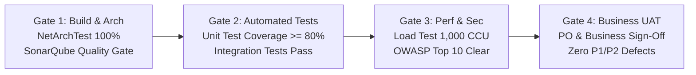

# 📊 Báo cáo Đánh giá Phát hành & Quản trị Chất lượng (Release Governance Report)

Tài liệu này xác lập tiêu chuẩn đánh giá, quy trình kiểm soát chất lượng qua từng cổng phát hành (Quality Gates) và kế hoạch quản trị rủi ro cho toàn bộ dự án **Enterprise BPMN Platform** theo chuẩn CMMI Level 3 và Agile Scrum Enterprise.

---

## 1. Tổng kết Phân bổ Nguồn lực & Cột mốc Phát hành

### 1.1. Bảng Tổng hợp Ma trận Sprint vs. Story Points vs. Hours

| Sprint | Tên Sprint | Module Trọng tâm | Story Points | Giờ Dev/QA (h) | Cột mốc Release |
|:---:|---|---|:---:|:---:|:---:|
| **Sprint 01** | Core Architecture, Access Governance & Audit | Kernel, Auth, Audit | 68 SP | 234h | **Release 1 (MVP)** |
| **Sprint 02** | Org Structure, Positions & Form Master Data | Org, Form | 71 SP | 226h | **Release 1 (MVP)** |
| **Sprint 03** | Elsa BPMN Engine & OneDrive Document Storage | Workflow, Document | 76 SP | 236h | **Release 1 (MVP)** |
| **Sprint 04** | Multichannel Notification & Internal News | Notification, News, Settings | 72 SP | 206h | **Release 2 (Automation)** |
| **Sprint 05** | Document Templates & SLA Escalation Automation | Document, Workflow | 72 SP | 182h | **Release 2 (Automation)** |
| **Sprint 06** | Local AI Copilot & Qdrant Knowledge RAG | AiCopilot | 68 SP | 192h | **Release 2 (Automation)** |
| **Sprint 07** | Enterprise System-wide Reporting & SLA BI | AnalyticsReporting | 73 SP | 220h | **Release 3 (BI & Go-Live)** |
| **Sprint 08** | Performance Tuning, Resilience & Production Cutover | Cross-Cutting, Tuning, Ops | 55 SP | 176h | **Release 3 (BI & Go-Live)** |
| **TỔNG CỘNG** | **Toàn bộ 8 Sprints Dự án (16 Tuần Vận hành)** | **11 Modules + Kernel** | **575 SP** | **1,672h** | **3 Releases Hoàn chỉnh** |

---

## 2. Tiêu chuẩn Đánh giá Cổng Chất lượng (Quality Gates)

Trước khi một gói Release được triển khai sang môi trường kế tiếp (Dev $\rightarrow$ Staging $\rightarrow$ Production), toàn bộ mã nguồn và hạ tầng phải vượt qua **4 Cổng Kiểm soát Chất lượng (Quality Gates)** nghiêm ngặt:



### Chi tiết Tiêu chí Từng Cổng:

| Cổng Kiểm soát | Tiêu chuẩn Đạt yêu cầu (Pass Criteria) | Công cụ Đánh giá Tự động | Tần suất Kiểm tra |
|---|---|---|---|
| **Gate 1: Kiến trúc & Mã nguồn** | - $100\%$ các bài kiểm tra ranh giới phụ thuộc giữa các module thành công.<br>- $0$ lỗi bảo mật (Vulnerabilities), $0$ điểm nóng (Security Hotspots), nợ kỹ thuật (Technical Debt) $< 3\%$. | NetArchTest, SonarQube Scanner | Mỗi lần Push / Tạo Pull Request |
| **Gate 2: Kiểm thử Chức năng** | - Tỷ lệ bao phủ mã nguồn (Code Coverage) tầng Domain & Application $\ge 80\%$.<br>- $100\%$ các bài kiểm thử tích hợp (Integration Tests) chạy thành công. | xUnit, Coverlet, TestContainers | Tự động chạy trong CI/CD Pipeline |
| **Gate 3: Hiệu năng & Chịu tải** | - P99 Read Latency $< 30\text{ ms}$, P99 Write Latency $< 100\text{ ms}$ tại tải 1,000 CCU.<br>- Tỷ lệ lỗi HTTP 5xx bằng $0.00\%$. | k6, BenchmarkDotNet | Cuối mỗi cột mốc Release |
| **Gate 4: Nghiệm thu Nghiệp vụ** | - $100\%$ kịch bản chấp thuận (Acceptance Criteria) được PO nghiệm thu.<br>- Không còn tồn đọng bất kỳ lỗi mức nghiêm trọng (P1 Blocker hoặc P2 Critical). | Jira / Azure DevOps Test Plans | Buổi Sprint Review & Demo |

---

## 3. Kế hoạch Dự phòng & Khôi phục Sự cố (Disaster Recovery & Rollback Plan)

Trong quá trình triển khai cập nhật hoặc Go-Live nếu phát sinh lỗi nghiêm trọng ảnh hưởng đến hoạt động doanh nghiệp, kịch bản Rollback tự động được kích hoạt:

```
Phát hiện Sự cố P1 (Treo hệ thống / Mất dữ liệu)
                     │
                     ▼
        [ Quyết định Rollback trong vòng 15 phút ]
                     │
         ┌───────────┴───────────┐
         ▼                       ▼
  [ Hạ tầng App ]         [ Cơ sở Dữ liệu SQL ]
  Cắt traffic Load        Chạy script Rollback
  Balancer sang slot      Idempotent hoàn trả
  cũ (Blue-Green Swap)    schema và restore backup
         │                       │
         └───────────┬───────────┘
                     ▼
           Hệ thống Khôi phục
           Hoạt động Bình thường (< 5 phút)
```

1. **Chiến lược Triển khai Xanh-Lam (Blue-Green Deployment):**
   - Ứng dụng chạy trên 2 cụm máy chủ song song: Cụm Blue (Hiện tại đang chạy) và Cụm Green (Bản mới).
   - Chỉ chuyển hướng Traffic tại Load Balancer khi Cổng `/healthz/ready` trên Cụm Green báo thành công 100%.
   - Nếu phát sinh lỗi, gạt ngược Load Balancer về Cụm Blue trong thời gian **$< 30\text{ giây}$**.
2. **Kế hoạch Rollback Database An toàn:**
   - Mọi script SQL Migration bắt buộc phải đi kèm script Rollback tương ứng (ví dụ: `20261105_AddApprovalHistory.sql` đi kèm `20261105_AddApprovalHistory_Rollback.sql`).
   - Tạo bản Snapshot Database tức thời trước mỗi đợt Release lên Production.

---

## 4. Chỉ số Đo lường Hiệu quả Vận hành (DORA Metrics sau Go-Live)

Hệ thống được theo dõi bằng 4 chỉ số vàng của kỹ thuật phần mềm thế giới (DORA Metrics):

1. **Deployment Frequency (Tần suất Triển khai):** Mục tiêu đạt $\ge 2\text{ lần/tuần}$ đối với các bản hotfix và tính năng nhỏ mà không gây downtime.
2. **Lead Time for Changes (Thời gian từ khi Code đến khi Lên Production):** Mục tiêu $< 48\text{ giờ}$ cho các tính năng tiêu chuẩn.
3. **Change Failure Rate (Tỷ lệ Triển khai Thất bại):** Khống chế ở mức $< 2\%$.
4. **Time to Restore Service (Thời gian Khôi phục khi có Sự cố - MTTR):** Cam kết xử lý khôi phục dịch vụ trong vòng $< 15\text{ phút}$.

